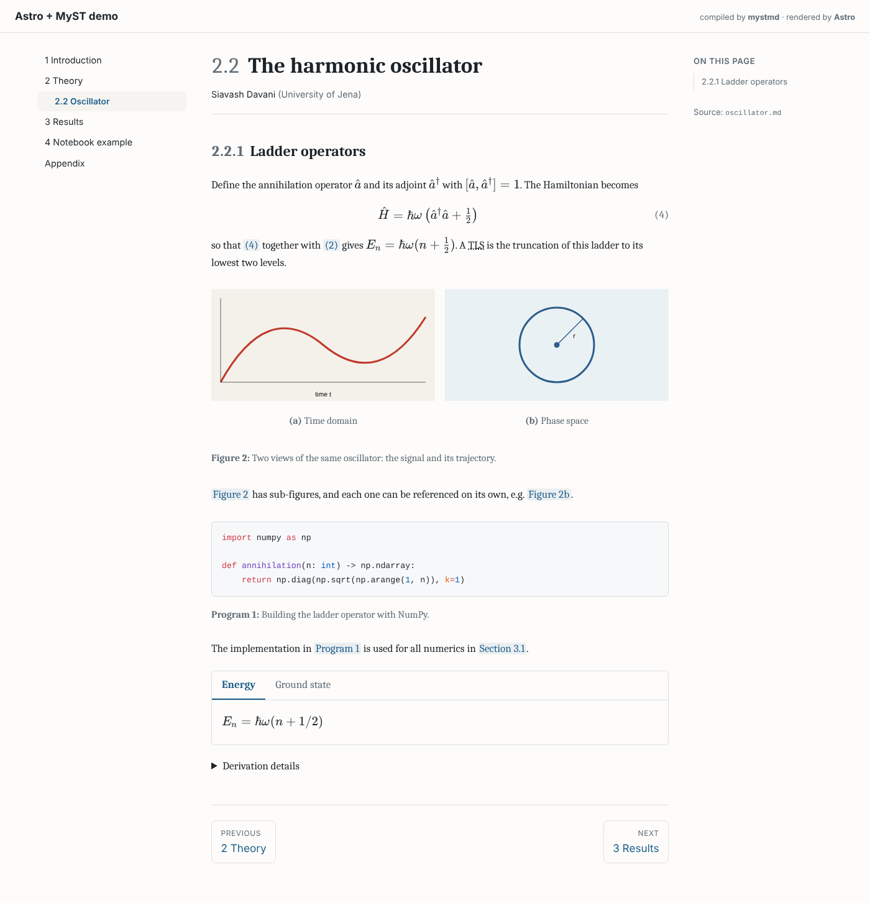
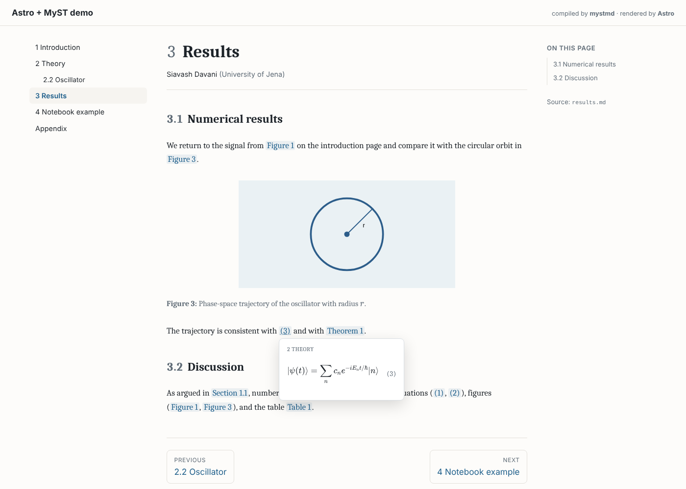

# astro-myst

Monorepo for [`astro-myst`](packages/astro-myst): render [MyST Markdown](https://mystmd.org) in [Astro](https://astro.build), compiled by the official `mystmd` engine, with automatic numbering, cross-page references, citations, math and notebooks.

| Path | What it is |
| --- | --- |
| [`packages/astro-myst`](packages/astro-myst) | The publishable npm package (Astro content loader, renderer, styles, `XrefPreview` component). Start with its README. |
| [`examples/book`](examples/book) | A small multi-page "book" site using the package: chapter numbering, figures/sub-figures, equations, theorems, BibTeX and DOI citations, tabs, a LaTeX (`.tex`) page, a notebook, an appendix with its own numbering. |





Tested with Astro 5.18, 6.4 and 7.3, and mystmd 1.3, 1.6, 1.8 and 1.11 (Node 22).

## Development

```sh
npm install
npm run build          # compile the package to packages/astro-myst/dist
npm run typecheck
npm test               # unit tests + integration tests that run the real mystmd
npm run example:dev    # http://localhost:4321, live-recompiles on content changes
npm run example:build
```

CI (`.github/workflows/ci.yml`) runs the tests on Linux/macOS/Windows, builds the example against Astro 5, 6 and 7 from the packed tarball, and publishes to npm when a `v*` tag is pushed.

## Publishing checklist

1. Check the name is still free: `npm view astro-myst` should return 404 (otherwise rename, e.g. `@your-scope/astro-myst`).
2. Add `repository`, `homepage` and `bugs` to `packages/astro-myst/package.json` once the GitHub repository exists.
3. Either publish manually (`npm login`, then `npm publish -w astro-myst`; `prepublishOnly` builds, type-checks and tests first), or add an `NPM_TOKEN` secret and push a tag such as `v0.1.0` to let CI publish with provenance.
4. Optionally submit it to the [Astro integrations library](https://astro.build/integrations/) (the `withastro` and `astro-loader` keywords are already set).
