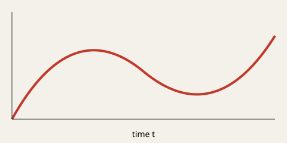

(sec-ladder)=
## Ladder operators

Define the annihilation operator $\hat a$ and its adjoint $\hat a^\dagger$ with
$[\hat a, \hat a^\dagger] = 1$. The Hamiltonian becomes

```{math}
:label: eq-ho
\hat H = \hbar\omega\left(\hat a^\dagger \hat a + \tfrac12\right)
```

so that @eq-ho together with @eq-energy gives $E_n = \hbar\omega(n+\tfrac12)$.
A TLS is the truncation of this ladder to its lowest two levels.

::::{figure}
:label: fig-panels
:class: subfigure-row



(fig-phase)=


Two views of the same oscillator: the signal and its trajectory.
::::

@fig-panels has sub-figures, and each one can be referenced on its own, e.g. @fig-phase.

```{code-block} python
:label: code-ladder
:caption: Building the ladder operator with NumPy.
import numpy as np

def annihilation(n: int) -> np.ndarray:
    return np.diag(np.sqrt(np.arange(1, n)), k=1)
```

The implementation in @code-ladder is used for all numerics in [](#sec-results).

::::{tab-set}
:::{tab-item} Energy
$E_n = \hbar\omega(n + 1/2)$
:::
:::{tab-item} Ground state
$\psi_0(x) \propto e^{-m\omega x^2 / 2\hbar}$
:::
::::

:::{dropdown} Derivation details
Insert $\hat x = \sqrt{\hbar/2m\omega}\,(\hat a + \hat a^\dagger)$ into the Hamiltonian.
:::
